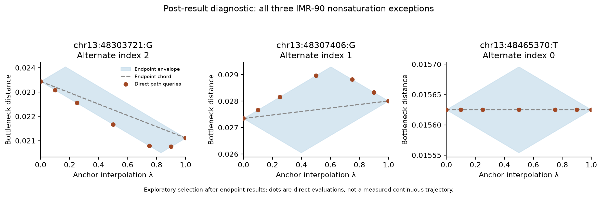

# Additional file 4: Track portability

This supplement concerns the same 84 sites and seven genes under a second AlphaGenome contact track. It is not a new cohort or independent model. The protocol was locally frozen before acquisition, then native-only predictions were locked before centered evaluation.

Technical transfer: PASS. Operational benchmark: PASS. The operational threshold was at least 17 additional leaders and gains in at least four genes, with no lost simple-bound decisions, complete data and no validation failures. It is not a powered hypothesis test.

## Gene-level primary results (tie tolerance 1e-6)

| Gene | Sites | Simple leaders | Strengthened leaders | Additional | Native credit | Centered credit |
|---|---:|---:|---:|---:|---:|---:|
| *ASS1* | 12 | 3 | 10 | 7 | 0.250000 | 0.083333 |
| *BAP1* | 12 | 0 | 11 | 11 | 0.333333 | 0.750000 |
| *BRCA2* | 12 | 1 | 8 | 7 | 0.305556 | 0.416667 |
| *HFE* | 12 | 0 | 4 | 4 | 0.347222 | 0.375000 |
| *RB1* | 12 | 2 | 2 | 0 | 0.444444 | 0.416667 |
| *SCN5A* | 12 | 0 | 6 | 6 | 0.347222 | 0.416667 |
| *TSC1* | 12 | 1 | 8 | 7 | 0.319444 | 0.333333 |

## Fixed tolerance sensitivities

| Tie tolerance | Simple leaders | Strengthened leaders | Additional | Native ties | Centered ties |
|---|---:|---:|---:|---:|---:|
| 0.0 | 7 | 50 | 43 | 75 | 0 |
| 1e-05 | 7 | 42 | 35 | 75 | 12 |
| 1e-06 | 7 | 49 | 42 | 75 | 1 |

## Fixed baseline comparisons

| Score | IMR-90 selected credit | GM12878 selected credit | IMR-90 agreement with centered top set |
|---|---:|---:|---:|
| absolute mean change | 0.410714 | 0.315476 | 58/84 |
| centered | 0.398810 | 0.321429 | 84/84 |
| centered rms | 0.517857 | 0.460317 | 36/84 |
| lifetime count absolute change | 0.349206 | 0.434524 | 33/84 |
| max absolute | 0.341270 | 0.357143 | 10/84 |
| maximum persistence absolute change | 0.353175 | 0.327381 | 16/84 |
| native | 0.335317 | 0.359127 | 9/84 |
| native minus absolute mean change | 0.244048 | 0.380952 | 16/84 |
| native plus absolute mean change | 0.410714 | 0.321429 | 64/84 |
| native rms | 0.500000 | 0.444444 | 39/84 |
| total persistence absolute change | 0.464286 | 0.333333 | 21/84 |

Deleting one gene leaves 31–42 additional leaders among 72 sites. The corresponding centered-minus-native credit ranges from +0.004630 to +0.101852. These are concentration diagnostics, not independent-sample uncertainty intervals.

## Provenance, controls and precision

Frozen source hashes and timestamps, all acquisition attempts and the exact per-site selections are retained in the experiment bundle. The two central SHA256 records are:

```text
Protocol:
56c5ae0650a02f05384e1d1cbc19f894d957d155f196a6db5432f9f36e10aa43
Native-prediction lock:
cc6ddc14d531f8e95974dbb69ae1b8dc3b7fdf73ed0f4201279836e1b52cef40
```

Both track channels were selected by exact metadata name. All 252 requests succeeded on their first attempt. Every repeated REF agreed, every contemporary GM12878 map equaled its historical counterpart, and every paired IMR-90 REF/ALT map differed from GM12878. All 132,120,576 delivered float32 values per track, including repeated reference arrays, were exactly bfloat16-representable. Equal outputs at these inputs do not establish immutable weights or biological measurement precision.

Nine phased-engine controls tested scientific equivalence, missing/changed locks, changed protocol, nonsaturation and wrong-leader detection. Twelve summary boundary controls tested the operational thresholds and incomplete data. The full replay checked 3696 scientific comparisons; 3696 were exactly equal. The independent per-site audit reports status PASS and maximum Hausdorff difference 0.

Bounds apply to the stored floating-point diagrams with a practical 1e-12 allowance, not a rigorous arithmetic enclosure. The matching solver uses zero approximation parameter. Added PH input rounding, observed grid structure and identical repeated outputs are separately described; none recovers latent model uncertainty. No runtime advantage, clinical accuracy improvement or experimental chromatin mechanism is established. No new clinical testing family was introduced.

The full protocol, machine-readable summary, independent audit, replay comparison and preserved execution correction accompany this supplement. Original discovery and replication evidence remains separately reported.

## Post-result direct path diagnostics

After the primary results were known, a separate local protocol specified direct evaluations of all three nonsaturating comparisons on the grid lambda = 0, 0.1, 0.25, 0.5, 0.75, 0.9 and 1. The diagnostic protocol and code were hashed before these additional queries. Selection was explicitly outcome-dependent and included all exceptions, with no change to the original cohort, primary endpoint or saved predictions.

| RB1 site (GRCh38), alternate index | Sampled behavior | Maximum departure from endpoint chord |
|---|---|---:|
| chr13:48303721:G, 2 | Direction changes on sampled grid | 0.000903 |
| chr13:48307406:G, 1 | Direction changes on sampled grid | 0.00129 |
| chr13:48465370:T, 0 | Flat on sampled grid | 1.08e-16 |

Alternate indices are zero-based in the saved alphabetical non-reference allele order. All 21 direct distances satisfied the two-endpoint envelopes, and endpoint recomputations agreed within 1e-12. Both simple and strengthened bounds had already abstained at all three sites at all fixed tolerances. This is conservative behavior shared by both bounds; it is not the witness-specific incremental advantage.



**Figure S4.1.** Post-result exploratory calculations for all three RB1 saturation exceptions. Points are direct matching computations at the seven specified lambda values and do not certify intervening behavior. Endpoint envelopes use their analytical kink vertices. Two sampled paths change direction, while one is effectively flat. Dashed chords are shown as a comparison, not an assumed interpolation. No exact turning location or matching identity is inferred.
