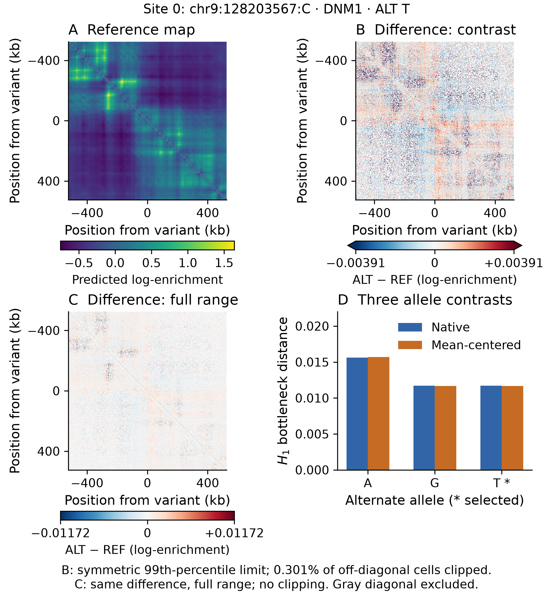

# Additional file 6: Reproducibility details

These records describe retained computational evidence. The complete inputs are provided through the v0.2.0 study archive identified in the main article. Full stored-map replay is distinct from verification of exported scalar results. Provider output terms and modification notices accompany the archive.

The within-site analyses and their numerical record are archived in the existing AlphaGenome reproduction package [1]. Its source code, curation records and supplementary tables give the complete empirical methods. An extraction manifest records selected machine-artifact values and hashes; extraction does not constitute independent regeneration of all earlier analyses. A separate targeted cache check reproduces the three reported AVI stratum counts and mean statistics and records their tie frequencies; it does not rerun their permutation tests. The schema probe and mathematical-example verifier accompany the present analysis. The verifier checks interval translation, scale normalization, paired diagram-alignment bounds, nonmonotonicity under vertex deletion, the distinction between bottleneck and Betti-curve distances, the failure of treating an arbitrary contact transform as a metric, tie-aware conditional nulls and rank invariance. No result from these finite examples is labeled a genomic observation.

The completed spatial reproduction bundle includes all raw per-call reference/alternate maps, assembled site arrays, coordinates, track metadata, input hashes, the locally frozen protocol, exact-matching settings, full diagrams, all sixteen conditional tests, numerical diagnostics and acquisition audits. The AlphaGenome client was version 0.9.0; its non-generated Python source matched the recorded vendored commit. ALL_FOLDS is a model alias; an immutable server weight revision was not exposed. The strengthened mathematical verifier passed eight check groups, including 100 randomized quotient comparisons. Independent inference checks include exhaustive finite-label distributions. These finite checks do not by themselves constitute a Lean formalization, a clean-environment regeneration of the retained audit, or biological validation.

The anchor extension additionally contains the frozen replication cohort and protocol, all 84 sites’ raw predictions, native diagrams, 252 endpoint comparisons, 21 direct midpoint checks, scalar reconstruction baselines, known-answer controls and independent derived-count checks. Exact rational finite checks exercise the local slope and endpoint-envelope arguments; independent Hera checks include turning and flat controls. The prospective engine retains failures and source hashes, and did not exclude any planned site. The numerical comparison tolerances and their limits accompany the outputs. Additional file 2 supplies the full proofs and counterexamples, and the integration map supplied with the review package records how this replacement incorporates the earlier contribution.

A subsequent validation pass regenerated all 204 spatial sites from cached maps in a fresh environment, including full diagrams, endpoint distances and the fixed midpoint checks. All 6,324 per-site comparisons passed the declared tolerances; 18 centered-distance vectors differed only at floating-point rounding scale. All sixteen conditional tests were independently recertified from the new outputs. The six retained historical output files regenerated byte-for-byte using their retained original random seeds. This checks execution reproducibility, not Monte Carlo precision. Linkage to each output is recorded in the validation report. The portable reproduction package pins its dependencies, inputs and expected outputs and preserves the failed setup and postprocessing attempts alongside their repairs. This reproduction checks computations on the retained inputs; it does not establish model accuracy or immutable server weights.

The cross-track extension retains its pre-acquisition protocol, all 252 two-track calls, the independently checked GM12878 drift control, the native-prediction lock, per-site diagrams and centered validations, and a full reference-engine replay. An independent reviewer recomputed Hausdorff witnesses with a separate brute-force implementation and reconstructed rankings and rational selected-allele credits from per-site files. The only execution correction was an initial import failure in the acquisition environment; the unchanged analysis ran in the existing fresh validation environment. Failed import logs and actual dependency versions are preserved. The portability validation report supplied with the review package distinguishes the new checks from the preceding full harness and its remaining human and provenance requirements.

## Cited archive

1. Iben P. Reproducibility package for “What do within-site comparisons of AlphaGenome Atlas predictions measure? An audit at ClinVar sites in 11 genes”. Zenodo, version 1.0, 2026. [doi:10.5281/zenodo.23537469](https://doi.org/10.5281/zenodo.23537469).

## Fixed illustrative site

{width=6.5in}

**Figure S6.1.** Fixed input-order site zero (chr9:128203567:C; DNM1; GM12878), not selected by effect size. **A**, reference predicted log-enrichment. **B**, selected-alternate T minus reference, with linear limits ±0.00390625 (99th percentile of absolute off-diagonal differences): 788/261632 cells (0.301%) color-clipped. **C**, identical differences at full linear range ±0.01171875, without clipping. Both scales are zero-centered in log-enrichment difference units. **D**, native and mean-centered H1 bottleneck distances for three alternate alleles; the asterisk marks the ClinVar-selected allele. Gray diagonals are excluded. No physical loop validation is implied. AlphaGenome-derived material remains subject to provider Output Terms identified in the main article.
