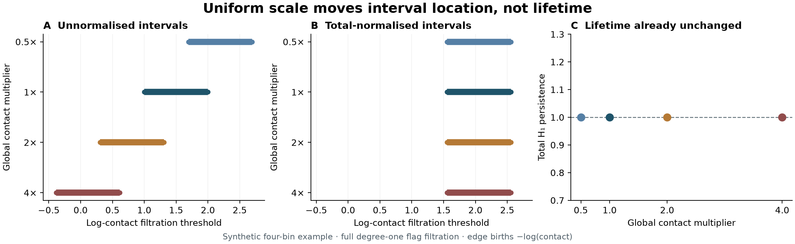
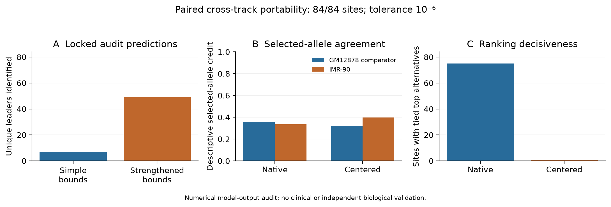
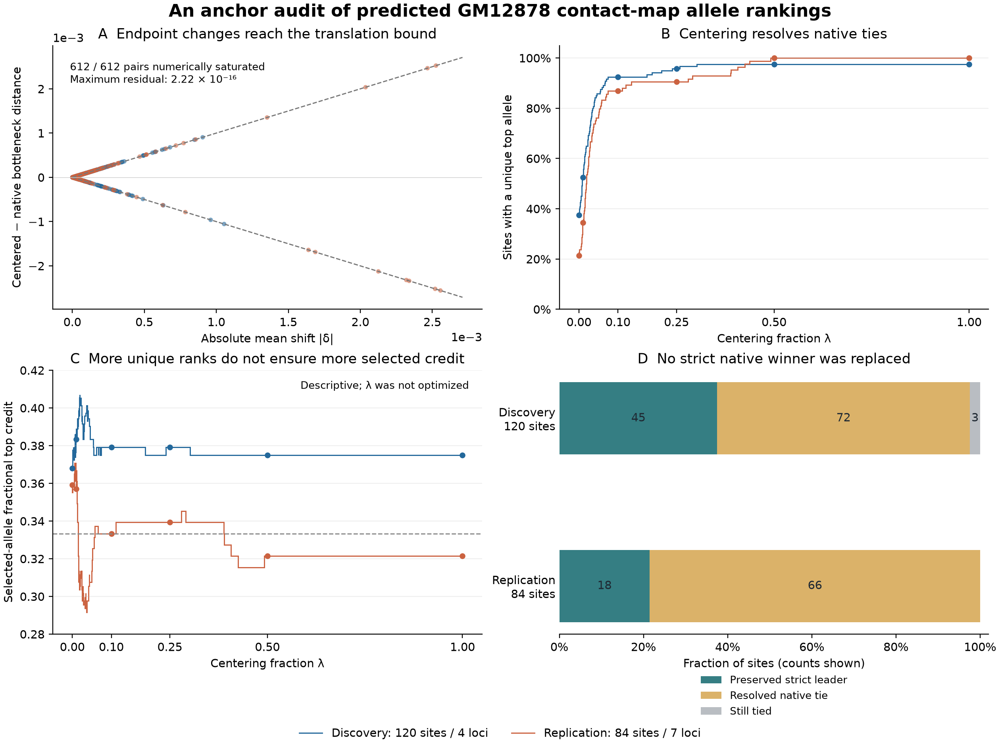
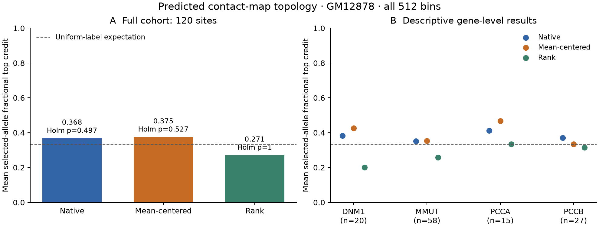

# Auditing preprocessing-sensitive allele rankings in predicted chromatin contact maps

Patrick Iben

Independent Researcher, Saint Petersburg, Florida, United States

Corresponding author: Patrick Iben; patrickiben@gmail.com

ORCID: 0009-0005-2443-7973

## Abstract

**Background:** Preprocessing can change allele rankings derived from predicted chromatin contact maps without changing the persistence-interval lifetimes used to summarize each map. We developed an audit to distinguish this representation effect from evidence of improved clinical discrimination. Its mathematical bounds use information from uncentered maps to identify which allele will receive the highest score after centering, while explicitly retaining unresolved comparisons. A complementary analysis describes how the distance changes along the centering path.

**Results:** We evaluated AlphaGenome predictions at 120 discovery sites and 84 sites in seven new loci, then locked native-only predictions for a paired IMR-90 test at the same 84 sites. A retained eleven-gene within-site analysis supplied complementary consequence controls. In GM12878, centering resolved 138 of 141 native ties and preserved all 63 strict leaders across discovery and replication. In IMR-90, strengthened bounds identified 49 of 84 centered leaders versus seven for simple bounds, adding 42 decisions across six genes with no contradictions against separately evaluated centered distances; 35 sites remained unresolved. Numerical endpoint saturation failed in three of 252 comparisons, and both methods abstained at their corresponding sites. Discovery selected-allele enrichment did not survive multiplicity correction. Selected-allele credit decreased descriptively after centering in GM12878 replication and increased in IMR-90; root-mean-square map baselines exceeded centered topological credit in both tracks.

**Conclusions:** The audit identifies when preprocessing makes topological allele rankings more decisive and which decisions remain unresolved. Evaluation supports its use on two output tracks of one prediction model. It does not establish clinical superiority or experimental structural validity.

**Keywords:** persistent homology; contact maps; genomic variant effects; preprocessing; bottleneck distance; numerical validation; AlphaGenome

## Background

AlphaGenome predicts molecular outputs from DNA sequence, and AlphaGenome Atlas exposes variant-effect profiles and an integrated AlphaGenome Variant Impact score (AVI) [1,2]. A ranking that places a clinically selected substitution first can reflect allele effects, molecular consequence, clinical ascertainment or the representation used to define the score. Within-site comparisons hold genomic position fixed while retaining these other sources of separation.

Contact-map topology makes this interpretation problem concrete. Independently mean-centering reference and alternate maps can translate their persistence diagrams by different amounts. Every interval lifetime stays unchanged, yet the between-diagram bottleneck distance can change. Small changes can break tied allele rankings. An analyst already using these topological summaries therefore needs to distinguish a more decisive representation from a more informative biological ranking.

We develop an executable audit of this specified preprocessing operation. Its inputs are persistence diagrams from uncentered maps, their bottleneck distances and map mean shifts; its outputs include bounded centered scores, uniquely determined leaders and explicit unresolved sets. After both endpoint distances are available, complementary bounds describe how the distance can change throughout the centering operation. We evaluate the method on spatial discovery data, prospectively selected new loci and a second output track with predictions locked before validation. The incorporated eleven-gene Atlas audit provides the complementary consequence and ascertainment controls. These form one integrated analysis of the information behind an allele ranking.

Persistent homology (PH) has established Hi-C applications, including Sauerwald and colleagues [3], topoHiC [4] and HICTDA [5], whose first version awaits peer review. Weighted-network precedents include Giusti and colleagues [6] and Petri and colleagues [7]. ICE addresses contact-map biases [8]; shift-invariant and normalized persistence comparisons address specified transformations [9,10,11]. Building on these established methods, we provide an executable audit that uses uncentered-map information to predict centered allele rankings, checks those predictions against separately calculated centered distances, and measures how many comparisons it resolves or leaves unresolved. Sequence-design work with Akita Semifreddo targets located boundaries, dots and flames [12], highlighting a distinct future validation target: abstract degree-one intervals are not automatically located chromatin loops.

## Methods

Supporting material covers vertex thinning (Additional file 1), anchor theory (Additional file 2), Monte Carlo scope (Additional file 3), paired-track portability (Additional file 4), the retained within-site audit (Additional file 5), reproducibility details (Additional file 6) and executable research verification (Additional file 7).

### Predicted maps and filtration

We analyze predicted maps, not observed read counts. AlphaGenome CONTACT_MAPS are signed log-fold enrichment over a genomic-distance-based expectation at 2,048-bp resolution [13]. Write this output as $L$. It is neither a nonnegative count matrix nor an absolute contact amount. The Atlas contact scorer is a separate aggregation of local absolute reference–alternate differences [14]; a vector of track scores is not a genomic-bin matrix. We acquired spatial maps separately from the retained score caches.

For each fixed set of 512 bins, set the unordered off-diagonal edge births to $w_{ij}=-L_{ij}$. This sign convention makes pairs with greater predicted contact enrichment enter the filtration earlier. At threshold $t$, include all vertices and edges with $w_{ij}\leq t$, then fill every clique. Full degree-one persistent homology (H1) over $\mathbb F_2$ gives $D_1(w)$. Each interval records the thresholds at which a one-dimensional topological feature appears and disappears; $\mathbb F_2$ specifies arithmetic modulo two. This weighted flag filtration requires no triangle inequality. On the finite complete support its degree-one diagram has no essential intervals. Bins, diagonal exclusion and support are identical within each reference–alternate comparison. There are 130,816 edges per map.

For two edge arrays on this support, standard filtration stability gives $d_B(D_1(w),D_1(v))\leq\lVert w-v\rVert_\infty$ [15]. Here $d_B$ is bottleneck distance, allowing matches to the diagonal; it is not a distance between Betti curves. A finite filtration cutoff or changed support requires additional conventions. Read thinning, vertex deletion and bin aggregation change different objects; none is tested as a biological endpoint here (Additional file 1). A model enhancing sampled input, such as DeepHiC [16], also inherits uncertainty from that input.

### Declared anchor path

For a contact map L, native edge births are $w=-L$. Here $a(L)$ is a single map-specific value, called the anchor, subtracted uniformly from all entries. Subtracting a scalar $a(L)$ from every entry of L adds $a(L)$ to both coordinates of every full H1 interval. Interval counts and lifetimes are unchanged. Total persistence, maximum lifetime and the supremum of the full Betti-one curve are therefore already invariant to a global additive log-enrichment offset. When L is a known log transform of positive weights, this offset corresponds to a multiplicative change in those weights. The interpretation of a scale change depends on the represented quantity.

Mean centering uses $a(L)=\operatorname{mean}_{i<j}L_{ij}$ on the shared off-diagonal support. For reference and alternate native diagrams $D_R$ and $D_A$, define $\delta=\operatorname{mean}L_A-\operatorname{mean}L_R$ and

$$f(\lambda)=d_B(D_R,D_A+\lambda\delta),\qquad 0\leq\lambda\leq1.$$

Here addition shifts both birth and death coordinates. Simultaneous translation of two diagrams leaves their bottleneck distance unchanged, so $f(0)$ is the native comparison and $f(1)$ is the comparison after independently centering both maps. This path isolates the effect of that particular preprocessing choice. It does not interpolate sequences or biological states. The parameter λ is dimensionless; f and δ have the native log-enrichment coordinate's units.

The construction applies to another scalar anchor by replacing δ with $a(L_A)-a(L_R)$. It requires common support and a full filtration. Clipping, pseudocounts, changes in bin support and finite filtration windows need separate analysis. Vertex loss is also distinct from a change in read depth; Additional file 1 gives the finite-bin extinction argument and its map-specific refinement.

For context, mean centering is a linear operator with exact supremum-norm constant $2(1-1/m)$ for m unordered edges. Thus, centering removes a common offset but can increase the largest edge-value difference between two maps, by at most this factor. Normalizing positive weights by their sum likewise selects a diagram origin after taking logarithms; it leaves full interval lifetimes unchanged. These identities motivate an audit of the resulting comparisons.

**Figure 1. Translation identity and invariant lifetimes.** A synthetic four-bin cycle illustrates global scaling before and after total normalization. Multipliers translate the degree-one interval (A); normalization aligns it (B); its lifetime is unchanged (C). This implementation example is not a genomic observation.

### Endpoint-derived whole-path envelopes

These lower and upper bounds use both the uncentered and centered endpoint distances. They audit the path after endpoint evaluation, rather than supply the prospective prediction tested below.

**Proposition (endpoint path bounds).** Write $T=|\delta|$, $A=f(0)$ and $C=f(1)$. For every λ in [0,1],

$$\max\{0,A-\lambda T,C-(1-\lambda)T\}
\leq f(\lambda)\leq
\min\{A+\lambda T,C+(1-\lambda)T\}.$$

In particular, $|C-A|\leq T$. If $|C-A|=T$, then $f(\lambda)=A+\lambda(C-A)$ throughout the segment.

**Proof.** Matching each interval to its translated copy gives $d_B(E+s,E+t)\leq|s-t|$. The triangle inequality makes the distance to $D_R$ a 1-Lipschitz function of the shift. Applying this inequality from each endpoint gives the bounds. When the endpoint difference equals T, the two bounds coincide. This argument requires neither a fixed optimal matching nor additional persistence computations.

Exact saturation determines an affine path; near saturation only bounds its departure. As a function of the diagram shift, finite bottleneck matching produces a continuous piecewise-affine distance with slopes −1, 0 or +1. With the normalized path parameter $\lambda$, the corresponding slopes are $-T$, 0 or $+T$. A shift segment contained entirely within a nonflat piece therefore saturates the endpoint bound. Additional file 2 gives deficit bounds, matching arguments and counterexamples. In numerical use, valid endpoint-error enclosures must widen the envelopes; a small floating-point residual alone is not such an enclosure.

### Native-only prediction of centered leaders

The prospective endpoint calculation does **not** use the centered distance $C$. For alternate $a$, use the native diagrams $D_R,D_a$, their bottleneck distance $A_a=d_B(D_R,D_a)$ and the signed mean shift $\delta_a$; write $T_a=|\delta_a|$. Form the pair of diagrams $(D_R,D_a+\delta_a)$. Using the maximum-coordinate ($\ell_\infty$) distance, compute for each point in either diagram the smaller of its distance to the nearest point in the other diagram and its own distance to the diagonal. Let $H_a$ be the largest of these values. Then $H_a\leq d_B(D_R,D_a+\delta_a)$: any complete matching must satisfy every point's nearest-neighbor requirement. This lower bound does not enforce a complete matching and cannot replace bottleneck distance.

The audit computes the following intervals before centered matching:

$$
I_a^{\rm simple}=[\max(0,A_a-T_a),\ A_a+T_a],\qquad
I_a^{\rm strong}=[\max(0,A_a-T_a,H_a),\ A_a+T_a].
$$

Here, higher rank means larger centered bottleneck distance. Given intervals $[L_a,U_a]$ and tie tolerance $\tau$, return a unique leader $i$ only if $L_i>\max_{j\ne i}U_j+\tau$. Otherwise return an unresolved set. An outer set of possible top members is $\{i:U_i\geq\max_{j\ne i}L_j-\tau\}$; an inner set of necessary top members is $\{i:L_i\geq\max_{j\ne i}U_j-\tau\}$. The outer set need not be sharp because score dependencies are ignored. All interval and set statements are conditional on valid bounds.

**Algorithm 1: native-only centered-ranking audit.** (1) Compute native diagrams, native distances and mean shifts on common support. (2) Construct the simple intervals. (3) Query nearest neighbors in the shifted diagrams to construct $H_a$ and intersect the lower bounds. (4) Apply the tolerance-aware leader and set rules, retaining every unresolved site. (5) Save the complete predictions. (6) For evaluation, compute centered bottleneck distances separately and check score coverage, top-set inclusion and leader agreement. Steps 1–5 require no centered matching and no clinical labels; step 6 is the validation target.

The empirical increment is the number of additional unique leaders resolved by step 3. Because the strengthened lower bound cannot decrease, retaining simple-bound decisions is structural, rather than independent evidence of performance. These are centered-endpoint decisions. A stricter native-margin condition, $A_i-A_j>T_i+T_j+\tau$ for every competitor, can guarantee the same leader throughout the path. The witness endpoint test does not by itself supply that whole-path guarantee. No net runtime speedup is inferred from avoiding centered matching in the prediction stage.

An increasing-branch witness satisfying $H_a=A_a+T_a$ meets the upper bound. A decreasing branch needs a different upper witness; we abstain when the available bounds are insufficient. Neither the scalar native distance nor the mean shift determines the direction: for $D=\{(0,4)\}$ and $E_\pm=\{(\pm1,4\pm1)\}$, both native distances are one, but the same shift $1/4$ yields $5/4$ and $3/4$. Multiplicity also matters: two copies of $(0,4)$ versus one give nearest-neighbor lower bound zero and bottleneck distance two. Additional file 2 develops these limitations.

The implemented intervals subtract $10^{-12}$ from lower bounds and add it to upper bounds. This is a practical allowance on stored floating-point diagrams, not a complete real-arithmetic enclosure. The theoretical guarantees and observed agreement must be read with that distinction. We use “identified leader” for a numerical prediction validated against the separately computed endpoint, not a clinically correct allele.

### Evaluation design and separation of prediction from validation

**Table 1. Evaluation stages and timing.** The paired track test reuses sites; it is not a third independent cohort.

| Stage | Input and scope | Timing and target |
|---|---|---|
| Retained within-site audit | Atlas score profiles in 11 genes; initial 120 sites, 384 pool-replication and 1,713 expanded-panel primary positions | Original analysis families; expanded-panel plan public before score retrieval |
| Spatial discovery | GM12878; 120 sites in 4 loci; 360 alternate comparisons | Local declaration before spatial analysis; primary centered selected-allele credit; path/witness analysis afterward |
| New-locus spatial replication | GM12878; 84 sites in 7 new loci; 252 comparisons | Cohort/protocol hashed before maps; saturation and ranking diagnostics; witness increment compared afterward |
| Paired track portability | IMR-90 at the same 84 replication sites; 252 comparisons | Protocol before acquisition; bounds, predicted leaders and unresolved sets locked before centered-distance evaluation; primary additional leader coverage |

Discovery used ClinVar-selected pathogenic or likely pathogenic coding substitutions in *DNM1* (20), *PCCA* (15), *PCCB* (27) and *MMUT* (58) [17]. Each coordinate has three non-reference substitutions. The replication selected 12 sites each in *ASS1*, *BAP1*, *BRCA2*, *HFE*, *RB1*, *SCN5A* and *TSC1* by deterministic hashing within consequence strata, with proportional residual allocation after reserving one site per nonempty stratum. All reference bases were checked against GRCh38. This gene-balanced design oversamples rare consequences. Windows did not overlap discovery windows or another selected gene, but overlapped substantially within genes: there are seven new locus regions, not 84 independent regions. The loci had historical nonspatial scorer results; prospective status concerns the specified new spatial outcomes.

GM12878 in situ Hi-C (4dn:4DNFIXP4QG5B; EFO:0002784) was selected before inspecting spatial allele results. AlphaGenome ALL_FOLDS returned 512 × 512 maps over 1,048,576-bp variant-centered windows. IMR-90 (4dn:4DNFIJTOIGOI; EFO:0001196) was selected from metadata as a distinct cell context with the same assay and resolution. Both tracks were requested together in all 252 portability calls. Thus this is a paired second-track test within one model, not an independent architecture, new-locus holdout or experimental assay.

For IMR-90, all 84 sites' native diagrams, distances, mean shifts, bounds and predictions were saved and hashed before any centered bottleneck evaluation. Technical transfer required complete acquisition, no validation failures and positive additional coverage. The fixed operational benchmark required at least 17 additional leaders across at least four genes, no contradicted decisions and no lost simple decisions. Seventeen was selected as half the earlier 34-site GM12878 gain; it is a utility threshold, not a powered statistical or clinical criterion. Primary tie tolerance was $10^{-6}$, with 0 and $10^{-5}$ sensitivities. The benchmark was not revised after results.

The tie tolerance governs ranking decisions; the saturation tolerance is a separate diagnostic of the endpoint bound. Numerical endpoint saturation used $\bigl||C-A|-|\delta|\bigr|\leq10^{-10}$, with tiny shifts reported separately. Direct midpoint calculations were fixed for all three alternates at the smallest-hash selected site in each replication gene: 21 checks per track. After IMR-90 results, a separate diagnostic protocol specified seven direct distances at $\lambda=0,0.1,0.25,0.5,0.75,0.9,1$ for all three nonsaturating comparisons. Those outcome-selected checks are exploratory and did not alter the locked primary analysis (Additional file 4).

### Clinical-label summaries and baseline comparisons

For the 120-site spatial discovery analysis, the protocol was recorded before analysis of the new spatial outcomes, with knowledge of the earlier profile audit. It is a local exploratory declaration, not a public preregistration. Its primary endpoint was selected-allele fractional top credit under mean-centered H1 distance. At each site, the selected allele received credit $1/k$ if it was among $k$ alternates whose scores were within an absolute tolerance of $10^{-6}$ of the maximum, and zero otherwise. Thus, an outright top rank earned 1, a two-way top tie earned 1/2, and a three-way tie earned 1/3. The rank filtration groups equal edge values and replaces each birth by the fraction of edges with strictly smaller native birth, retaining stronger contacts first (Additional file 2). Native enrichment, rank enrichment and the two-sided centered-minus-native paired credit contrast completed a four-test family. Exact ties and tolerance 10⁻⁵ were declared descriptive sensitivities.

Under the primary null, each site's selected label is drawn independently and uniformly from its three alternatives, conditional on all maps. Expected fractional credit is 1/3 even with ties. The paired null uses the same label for both representations and tests absolute deviation around its conditional expectation. Dynamic-programming convolution on the sixth-credit lattice evaluates the finite null distribution. An initial float64 implementation agreed with independent exhaustive-enumeration checks within 3.22 × 10⁻¹⁵. A separate implementation then reconstructed all sixteen tests with integer polynomial coefficients and exact rational probabilities, including paired expectations, inclusive tails and multiplicity adjustments; its largest discrepancy from the reported floating values was 6.83 × 10⁻¹⁶. This certifies the label-probability arithmetic conditional on the computed credits, not the map predictions or the scientific null. Holm [18] and Benjamini–Yekutieli (BY) [19] adjustments cover all four main tests. The product-label model does not establish biological independence among overlapping windows or sites in the same gene.

Three sensitivity nulls were fixed: consequence matching; transition/transversion weights 4/1 with an additional factor of ten for CpG transitions; and both together. Consequence matching retains all 120 sites, including 26 with a unique eligible label and thus deterministic contributions. Applying the four tests under the primary null and each of the three sensitivity nulls gives sixteen tests, all reported with an additional Holm adjustment. These weights are assumptions, not measured clinical ascertainment probabilities. Coordinate-sensitive map differences and a consequence-severity rule are descriptive baselines. The prior 66-comparison profile family remains separate.

For every representation we compare fractional selected-allele credit, not validated pathogenic-versus-benign accuracy. An unselected alternative is not necessarily benign. Absolute mean change, native and centered root-mean-square (RMS) map differences, maximum edge change, interval count and lifetime differences, and native distance plus/minus absolute mean shift provide descriptive baselines. No new clinical-enrichment testing family was introduced for spatial replication or portability. Gene-level and leave-one-gene-out summaries describe concentration, without treating overlapping windows as independent biological samples.

The retained Atlas audit evaluated 22 scorers in three geometries with within-site randomization, declared multiplicity families and consequence/mutation sensitivities. AVI includes AlphaMissense and consequence-related features [2,20,21]. The retained audit's reported 9,999-draw tests use plus-one p-values [22], Benjamini–Hochberg (BH) [23] and specified BY [19] corrections; several highlighted cells reach the Monte Carlo floor. Additional files 3 and 5 preserve the complete methods, ascertainment, baselines and adverse results. The publicly deposited expanded-panel plan preceded score retrieval [24]; the original reproducibility package is archived [25].

### Computation, verification and AI assistance

Ripser computed full H1 without interval censoring. GUDHI 3.13.0 CGAL ($e=0$) and Hera (approximation parameter zero) supplied bottleneck matching, with per-record solver provenance and cross-solver checks. “Exact matching” refers to the supplied diagram coordinates, not model accuracy or elimination of floating-point error. Added float32 filtration-conversion errors were recorded separately. AlphaGenome client 0.9.0 used the ALL_FOLDS alias; an immutable server weight revision and model-training independence were not established.

Stored-map re-execution in a fresh environment covered all 204 GM12878 spatial sites. The sixteen conditional label tests were independently recomputed, and the retained historical analyses were rerun. For IMR-90, an unmodified reference-engine replay covered all 84 sites; separate brute-force nearest-neighbor code checked every witness and independently reconstructed rankings and rational credits. That full replay used the original persistent-homology implementation. Known-answer controls include increasing, turning, flat, zero-shift and multiplicity cases.

A targeted check with Ripserer 0.17.0 [26] in Julia 1.13.0 separately reconstructed 72 full H1 diagrams from nine replication sites on both tracks, including every known IMR-90 nonsaturation exception. All 847,288 intervals matched the original diagrams exactly on identical effective float32 filtration inputs, with multiplicity preserved. Twenty-two small-graph controls matched an explicit boundary-matrix reduction. Recalculation from the Julia diagrams preserved the checked distances, ranking decisions and all three exceptions. This is agreement between separate implementations in the Ripser algorithm family; downstream bottleneck matching still used Hera. The check does not establish full-cohort cross-implementation agreement or biological validity. Additional file 6 records execution, solver and preservation details. The public MIT-licensed Anchor Audit Toolkit implements the bound calculations and a browser demonstration [27,28]; the research-data access status is stated separately below.

Generative artificial intelligence (AI) through OpenAI Codex assisted study and audit-procedure development; mathematical derivation and adversarial checking; code for acquisition, processing, statistics and verification; manuscript drafting and revision; and literature/source checks. Qwen3.8 assisted earlier manuscript drafting. Author-supplied quality-control reports were generated with Qwen3.8-Max; accepted suggestions were checked against the source files and underlying artifacts before revision. These checks supplement author review rather than constitute external peer review. AlphaGenome generated the molecular predictions analyzed here, which are model outputs rather than experimental measurements. The author is responsible for the submitted work; no AI system is an author.

## Results

### Prospective centered-leader coverage

**Table 2. Centered-leader coverage at tie tolerance $10^{-6}$.** All reported leaders agreed with independently evaluated centered matching. GM12878 increments were compared after those outcomes; IMR-90 predictions were locked first.

| Quantity | GM12878 discovery | GM12878 replication | IMR-90 paired test |
|---|---:|---:|---:|
| Sites | 120 | 84 | 84 (same replication sites) |
| Simple-bound leaders | 45 | 18 | 7 |
| Strengthened-bound leaders | 89 | 52 | 49 |
| Additional leaders | 44 | 34 | 42 |
| Unresolved after strengthening | 31 | 32 | 35 |
| Contradicted leaders | 0 | 0 | 0 |

The prospective IMR-90 calculation increased decision coverage from 7/84 to 49/84, adding 42 leaders (50 percentage points) across six genes. There were no score-interval failures, ranking-set failures or contradicted leader predictions. Thirty-five sites remained unresolved. Unresolved denotes insufficient separation of the bounds; it does not necessarily indicate a tie in the directly computed centered scores. Gains were ASS1 7, BAP1 11, BRCA2 7, HFE 4, RB1 0, SCN5A 6 and TSC1 7. Removing any one gene retained 31–42 additional decisions. The frozen technical and operational criteria were met. The increment was 43 at zero tolerance and 35 at $10^{-5}$, again without validation failures. These are observed agreements on stored diagrams, not estimates of clinical accuracy or a population error bound.

All 252 paired calls succeeded on the first attempt. All repeated references were identical; every contemporary GM12878 reference and alternate array matched its historical counterpart exactly, whereas every paired IMR-90 map differed from GM12878. Delivered values in both tracks were bfloat16-representable. Equality at the queried inputs supports the contemporaneous comparison but does not identify immutable weights. Independent brute-force witness calculation agreed exactly in all 252 comparisons. Reference-engine replay matched all 3,696 recorded field and array comparisons exactly, including 336 full persistence diagrams (Additional files 4 and 6).

**Figure 2. Paired cross-track decision coverage and descriptive rankings.** A: unique leaders identified by locked simple and strengthened bounds before centered evaluation. B: descriptive native/centered selected-allele credit in the two tracks. C: IMR-90 native and centered tied top sets. Endpoints are computed directly. The tracks share sites and model architecture; no clinical-accuracy interval or runtime advantage is implied.

### Saturation, exceptions and tie resolution

Across GM12878 discovery and replication, all 612 comparisons numerically saturated the endpoint translation bound, with maximum residuals $2.08\times10^{-16}$ and $2.22\times10^{-16}$. Centering increased 278/360 discovery distances and 182/252 replication distances, decreasing the remainder. The 21 fixed replication midpoint checks differed from the straight lines joining the endpoint distances (the endpoint chords) by at most $8.33\times10^{-17}$. These finite checks support the numerical affine description on the computed diagrams. They do not prove exact equality for unexposed model outputs.

Universal saturation did not transfer to IMR-90: 249/252 comparisons passed, with no tiny shifts. All three exceptions occurred in RB1; the maximum deficit was 0.002583775382. Both simple and strengthened bounds had already abstained at all three corresponding sites. Thus the witness's distinct contribution is its additional coverage elsewhere, not unique detection of these exceptional paths.

All 21 prespecified IMR-90 midpoint checks passed both chord and envelope tolerances; one sampled the effectively flat exception. A nonsaturating path can still be straight: when a nonzero shift leaves the distance constant, the endpoint change is zero rather than the full shift magnitude. Subsequent direct evaluations at seven fixed lambda values showed two paths changing direction on the sampled grid, with maximum chord departures 0.000903377 and 0.001291888; the third was flat within $10^{-12}$. All 21 exploratory values remained inside the endpoint envelopes. This diagnoses the sampled behavior without identifying exact turning locations, matching identities or unmeasured intermediate rankings (Additional file 4).

At tolerance $10^{-6}$, centering resolved 72 of 75 discovery ties and all 66 GM12878 replication ties, preserving all 45 and 18 strict native leaders. Every centered top set remained inside its native top set; no strict leader reversed. The simple margin bound supported those leaders throughout the path. In IMR-90, centering resolved 74 of 75 native ties and preserved all nine strict leaders. Interval lifetimes remained unchanged in every map by the translation identity. The repeated increase in unique rankings is therefore a representation effect whose clinical interpretation needs separate evidence.

**Figure 3. Anchor-path audit in discovery and new-locus replication.** A: distance changes versus absolute mean shift and translation bounds. B: unique top sets along the fixed path at tolerance $10^{-6}$. C: selected-allele fractional credit; lambda was not optimized. D: native ties, ties resolved and preserved strict leaders. Step curves use open intervals between tolerance breakpoints under the endpoint-derived affine description; points show the fixed grid. Direct midpoint checks test that description. No independent biological-sampling uncertainty is implied.

### Selected-allele credit and stronger scalar baselines

**Table 3. Discovery conditional selected-credit tests.**

| Representation | Selected mean credit | Conditional p | Holm (four tests) | BY (four tests) |
|---|---:|---:|---:|---:|
| native | 0.368056 | 0.124151 | 0.496606 | 0.73254 |
| centered | 0.375000 | 0.17581 | 0.527429 | 0.73254 |
| rank | 0.270833 | 0.937372 | 1 | 1 |
| centered minus native | 0.006944 | 0.845665 | 1 | 1 |

The first three rows test one-sided enrichment above the uniform expectation of 1/3; the final row tests a paired difference around zero. None was significant after the declared four-test correction. The centered primary endpoint exceeded the uniform expectation of 1/3 by 0.041667; its increase over native mean credit was 0.006944. For its sensitivity nulls: consequence matched: expected credit 0.3264, p = 0.1001, Holm across all sixteen tests = 1; mutation w4 cpg10: expected credit 0.31875, p = 0.06459, Holm across all sixteen tests = 0.896; consequence and mutation: expected credit 0.2953, p = 0.006084, Holm across all sixteen tests = 0.09735. No main or sensitivity test survived Holm adjustment over all sixteen tests. These findings do not establish absence of all biological effects. Conditional null reference intervals, gene-level estimates and leave-one-gene-out summaries are retained with the spatial outputs. Null reference intervals are not effect confidence intervals. The descriptive gene-cluster resampling interval uses only four purposively selected genes and cannot support population-wide coverage.

Selected credit decreased from 0.359127 to 0.321429 after centering in GM12878 replication, but increased from 0.335317 to 0.398810 in IMR-90. Native/centered RMS credits were 0.444444/0.460317 in GM12878 and 0.500000/0.517857 in IMR-90, exceeding centered H1 in both tracks. IMR-90 mean-only credit was also higher (0.410714). These descriptive comparisons do not support topological predictive superiority. Native and centered top sets agreed between tracks at only 33/84 and 35/84 sites, respectively.

The native-distance-plus-absolute-mean-shift baseline reproduced 103/120 discovery and 64/84 replication centered top sets, and 64/84 IMR-90 top sets. In GM12878 replication it had the same aggregate selected credit as centering despite disagreeing at 20 sites. Matching aggregate performance is therefore not equivalent to reproducing individual decisions.

**Figure 4. Discovery selected-credit estimates.** Fractional top credit at all 120 discovery sites, with uniform-label expectation 1/3. Gene points are descriptive. Holm values use the full four-test primary family. No gene was selected by its result.

### Consequence controls from the retained within-site audit

The incorporated Atlas audit illustrates the complementary effect of clinical ascertainment and consequence. In the seven-gene expansion, ranking AVI Euclidean distance from a background centroid placed the ClinVar allele first at 1,095/1,238 nonsense or start-loss positions (88%) and 94/246 missense positions (38%). Across all 1,490 coding positions, including six synonymous positions, the observed first-choice fraction was 1,192/1,490 (0.800), below the exploratory model-free consequence-severity rule's expected 0.817. This supports including strong non-topological explanations before interpreting enrichment.

Ten of 66 coding comparisons remained significant under the matched-consequence null, compared with 37 under the uniform null. Given 37 significant comparisons under the uniform null, the prespecified “mainly consequence class” criterion required nine or fewer under consequence matching. The observed count of ten did not meet that criterion. Eligible cohorts also differed (452 versus 1,490 AVI positions), so this was not a fixed-cohort null comparison. Three redraws reproduced 37/10, but simultaneous Monte Carlo count enclosures of 36–37 and 8–11 could not certify the criterion (Additional file 3).

Missense AVI mean-statistic enrichment persisted under the consequence/mutation null (reported q=0.00132), while the observed mean selected-minus-largest-other margin remained negative (−0.0128 versus null mean −0.0829). Outside chr13 it was −0.0407 versus −0.0785 (q=0.00165). The reported q-values are multiplicity-adjusted estimates derived from raw p-values at the Monte Carlo simulation floor. The mean selected-minus-largest-other margins remain negative despite enrichment relative to the specified null. Three splicing scorers ranked the selected allele first at 46, 47 and 47 of 63 other-intronic sites, whereas no mean-statistic comparison was significant at 157 canonical-splice positions. Computational evidence may contribute to clinical classifications [29,30]. Additional files 3 and 5 retain these results, their Monte Carlo limitations, earlier contact-profile results and all eligibility rules. Direct spatial REF–ALT comparisons remove the external centroid but do not remove consequence, ascertainment or label-circularity concerns.

## Discussion

The GM12878 discovery and new-locus replication reproduce the observed centering-associated tie resolution. In those two cohorts, centering operated on numerically saturated branches of the bottleneck translation path. It resolved native ties while preserving every strict native leader and every individual interval lifetime. The path audit makes this behavior inspectable: a reader can identify the anchor, see which comparisons move, and determine which allele decisions remain unresolved at the stated tolerance.

The IMR-90 test separates general audit utility from the earlier saturation pattern: the strengthened bounds added 42 decisions across six genes even though three comparisons failed numerical saturation. Both simple and strengthened bounds retained unresolved sets at all three exceptional sites. This prospective check supports use of the bounded audit beyond a dataset in which every endpoint happens to saturate. It does not establish universal saturation or transfer to an independent model.

The clinical and representational findings answer different questions. The discovery analysis did not establish selected-allele enrichment after its declared multiplicity corrections. GM12878 replication produced more unique rankings but a descriptive decrease in selected-allele credit; the paired IMR-90 change was positive. The direction of this descriptive change therefore depended on the track, and RMS baselines exceeded centered H1 in both tracks. The original within-site results likewise required consequence and mutation controls. A summary's ability to distinguish alternatives must be assessed against the information it retains and the way the evaluated labels were selected.

The audit combines established stability and matching results into a procedure for identifying centered-ranking decisions from uncentered inputs and describing the path after both endpoints are evaluated. Its empirical contribution is the gain in decision coverage demonstrated prospectively on a second AlphaGenome track, with unresolved cases retained explicitly. The new-locus analysis, consequence controls and simpler baselines place these decisions in their genomic and statistical context.

The source maps are predictions from one model on GM12878 and IMR-90 tracks. The paired IMR-90 extension reuses the seven replication loci; it increases track coverage without adding independent loci or model architectures. The selected ClinVar sites were not curated for experimentally verified chromatin-contact disruption. At each site, one alternate is ClinVar-selected and the other two are unselected; these alternatives do not form an independently validated pathogenic-versus-benign set. The eleven loci and overlapping within-gene windows limit generalization; the gene-balanced replication also differs from the eligible panel's consequence distribution. Historical scorer exposure and unestablished model-training independence limit stronger holdout claims.

Delivered values lie on a bfloat16 grid. This observation, together with the finite matching geometry, makes numerical resolution relevant to ties. It does not establish that quantization causes every tie or saturation event; a higher-precision comparison would be needed to isolate that contribution. The recorded PH rounding bounds address added filtration conversion. The practical solver allowances and numerical witness checks do not constitute complete real-arithmetic certificates. Exact theoretical path bounds remain conditional on valid endpoint errors when used for rigorous numerical enclosures.

Mean centering removes a declared additive offset and retains relative diagram-location information. Neither the mean alone nor the native scalar distance determines the directional response. The alternative shift-invariant distance optimizes over origins and addresses a different target; it was not substituted for the frozen endpoint. Abstract H1 diagrams also discard genomic labels. Observed-contact data, perturbations with known local structural effects and coordinate-sensitive comparisons would be required to connect the present model-output audit to physical chromosome architecture. Those are open validation tasks.

## Conclusions

The audit uses information from uncentered maps to identify centered allele-ranking leaders while retaining unresolved cases. In the prospective IMR-90 test, strengthened bounds increased coverage from 7 of 84 to 49 of 84 sites, adding 42 decisions across six genes; 35 sites remained unresolved. All predicted leaders agreed with separately evaluated centered distances, although universal numerical saturation did not transfer. These findings support the audit’s use on the two evaluated AlphaGenome tracks. They do not establish improved clinical prediction. Validation with other model architectures and experimental contact data remains future work.

## Abbreviations

AI: artificial intelligence; ALT: alternate allele; AVI: AlphaGenome Variant Impact; BH: Benjamini–Hochberg; BY: Benjamini–Yekutieli; H1: degree-one persistent homology; PH: persistent homology; P/LP: pathogenic or likely pathogenic; REF: reference allele; RMS: root mean square.

## Declarations

### Ethics approval and consent to participate

Not applicable. This computational study uses public variant annotations and model predictions, with no new participant recruitment or intervention.

### Consent for publication

Not applicable. No identifiable participant information is reported.

### Availability of data and materials

The retained within-site analysis is archived in Zenodo [25]. Anchor Audit Toolkit is available from its source repository [27]; the complete study archive is preserved in the versioned v0.2.0 release [28]. The full archive contains the stored maps, paired calls, full diagrams, frozen protocols, computational source and execution records, including the earlier reproduction capsule. Its three download parts have checksums and reassembly instructions. The targeted Julia validation has a separate downloadable capsule, identified with its checksum in Additional file 6. Additional file 7 supplies a compact scalar-verification archive for checking the paired-track counts, bounds and credits without model access; these scalar results alone cannot regenerate persistence diagrams. The release README distinguishes full stored-map replay from scalar verification and acquisition preparation.

Project: Anchor Audit Toolkit. Home page: reference [27]. Study code and data archive: v0.2.0 [28]. Operating systems: platform independent; Python reference CLI and JavaScript browser demo. The reference toolkit requires Python 3.10 or later, with no runtime dependencies; the optional accelerated stack requires Python 3.12 or later and the pinned compatible packages. Original software license: MIT. AlphaGenome outputs and substantial derivatives, including the derived genomic numerical results and Figures 2–4, S4.1 and S6.1, are subject to the legally binding AlphaGenome Output Terms [31], separately from the software license. The archive includes those terms, required notices and a modification record. Processing includes mean centering, persistence analysis, ranking and visualization; saved raw map arrays retain their original bytes. No blanket MIT or Creative Commons license over provider outputs is asserted.

### Competing interests

The author declares no competing financial or nonfinancial interests.

### Funding

This work received no specific grant or institutional funding.

### Authors' contributions

P.I. developed the research program and is responsible for the study design, analyses, interpretation and manuscript. Generative-AI assistance is disclosed in Methods. Final author approval of this proposed revision remains pending.

### Acknowledgements

Not applicable.

## Additional files

**Additional file 1 (PDF): Vertex thinning.** Finite-bin extinction argument and map-specific refinement; a scope control, not an empirical read-depth analysis.

**Additional file 2 (PDF): Anchor theory.** Proofs, matching arguments, invariance comparisons and counterexamples supporting the audit.

**Additional file 3 (PDF): Monte Carlo scope.** Simulation-floor precision and interpretation of retained within-site tests.

**Additional file 4 (PDF): Track portability.** Frozen design, gene-level outcomes, tolerances, baselines and exploratory exception paths.

**Additional file 5 (PDF): Retained within-site audit.** Complete incorporated methods and results, including adverse controls and ascertainment limitations.

**Additional file 6 (PDF): Reproducibility details.** Acquisition, replay, numerical checks, preservation records and the fixed-site contact-map illustration.

**Additional file 7 (ZIP): Compact scalar-verification archive.** Source, environment records, protocols and derived scalar data for checking bounds, ranking sets and selected-allele credits. Recomputing persistence diagrams requires the saved maps in the separate full study archive.

## References

1. Avsec Z, Latysheva N, Cheng J, et al. Advancing regulatory variant effect prediction with AlphaGenome. *Nature*. 2026;649:1206–1218. [doi:10.1038/s41586-025-10014-0](https://doi.org/10.1038/s41586-025-10014-0).
2. Cheng J, Taylor KR, Nicolaisen L, et al. AlphaGenome Atlas: in silico mutagenesis of the entire human genome improves prioritization and interpretation of non-coding variants. *medRxiv*, preprint, 2026. [doi:10.64898/2026.09.16.26363192](https://doi.org/10.64898/2026.09.16.26363192).
3. Sauerwald N, Shen Y, Kingsford C. Topological Data Analysis Reveals Principles of Chromosome Structure in Cellular Differentiation. *WABI 2019, LIPIcs*. 2019;143:23:1–23:16. [doi:10.4230/LIPIcs.WABI.2019.23](https://doi.org/10.4230/LIPIcs.WABI.2019.23).
4. Chiang Z, Wu Y. Persistent homology-based multiscale Hi-C analysis uncovers TADs-mediated gene regulation. *Scientific Reports*. 2026;16:22347. [doi:10.1038/s41598-026-52335-8](https://doi.org/10.1038/s41598-026-52335-8).
5. Mustafa A. HICTDA: A Persistent Homology Framework for Multiscale Identification of Topologically Associating Domains (TADS) in Hi-C Data. *F1000Research*. 2026;15:1752, version 1, awaiting peer review. [doi:10.12688/f1000research.189367.1](https://doi.org/10.12688/f1000research.189367.1).
6. Giusti C, Pastalkova E, Curto C, Itskov V. Clique topology reveals intrinsic geometric structure in neural correlations. *PNAS*. 2015;112:13455–13460. [doi:10.1073/pnas.1506407112](https://doi.org/10.1073/pnas.1506407112).
7. Petri G, Expert P, Turkheimer F, et al. Homological scaffolds of brain functional networks. *Journal of the Royal Society Interface*. 2014;11:20140873. [doi:10.1098/rsif.2014.0873](https://doi.org/10.1098/rsif.2014.0873).
8. Imakaev M, Fudenberg G, McCord RP, et al. Iterative correction of Hi-C data reveals hallmarks of chromosome organization. *Nature Methods*. 2012;9:999–1003. [doi:10.1038/nmeth.2148](https://doi.org/10.1038/nmeth.2148).
9. Sheehy D, Kisielius O, Cavanna N. Computing the Shift-Invariant Bottleneck Distance for Persistence Diagrams. *Proceedings of the 30th Canadian Conference on Computational Geometry*. 2018:78–84. [Primary paper](https://donsheehy.net/research/cavanna18computing.pdf).
10. Cao Y, Monod A, Vlontzos A, Schmidtke L, Kainz B. Topological information retrieval with dilation-invariant bottleneck comparative measures. *Information and Inference*. 2023;12(3):1964–1996. [Publisher article](https://academic.oup.com/imaiai/article/12/3/1964/7217093).
11. May NH, Krishnamoorthy B, Gambill P. A Normalized Bottleneck Distance on Persistence Diagrams and Homology Preservation under Dimension Reduction. *La Matematica*. 2024;3:1486–1509. [doi:10.1007/s44007-024-00130-0](https://doi.org/10.1007/s44007-024-00130-0).
12. Smaruj PN, Kelley DR, Fudenberg G. Sequence design for three-dimensional genome folding using Akita Semifreddo. *Genome Biology*. Accepted article published 26 October 2026. [doi:10.1186/s13059-026-04313-6](https://doi.org/10.1186/s13059-026-04313-6).
13. Google DeepMind. [Model output metadata](https://www.alphagenomedocs.com/exploring_model_metadata.html). AlphaGenome documentation, accessed 28 October 2026.
14. Google DeepMind. [ContactMapScorer](https://www.alphagenomedocs.com/api/generated/alphagenome.models.variant_scorers.ContactMapScorer.html) and [How variant scoring works](https://www.alphagenomedocs.com/variant_scoring.html). AlphaGenome documentation, accessed 28 October 2026.
15. Chazal F, de Silva V, Glisse M, Oudot S. *The Structure and Stability of Persistence Modules*. SpringerBriefs in Mathematics. 2016. [doi:10.1007/978-3-319-42545-0](https://doi.org/10.1007/978-3-319-42545-0). Earlier version: [arXiv:1207.3674v3](https://arxiv.org/abs/1207.3674v3), 2013.
16. Hong H, Jiang S, Li H, et al. DeepHiC: A generative adversarial network for enhancing Hi-C data resolution. *PLOS Computational Biology*. 2020;16:e1007287. [doi:10.1371/journal.pcbi.1007287](https://doi.org/10.1371/journal.pcbi.1007287).
17. Landrum MJ, Chitipiralla S, Kaur K, et al. ClinVar: updates to support classifications of both germline and somatic variants. *Nucleic Acids Research*. 2025;53:D1313–D1321. [doi:10.1093/nar/gkae1090](https://doi.org/10.1093/nar/gkae1090).
18. Holm S. A Simple Sequentially Rejective Multiple Test Procedure. *Scandinavian Journal of Statistics*. 1979;6(2):65–70. [Journal archive](https://www.jstor.org/stable/4615733).
19. Benjamini Y, Yekutieli D. The control of the false discovery rate in multiple testing under dependency. *Annals of Statistics*. 2001;29:1165–1188. [doi:10.1214/aos/1013699998](https://doi.org/10.1214/aos/1013699998).
20. Cheng J, Novati G, Pan J, et al. Accurate proteome-wide missense variant effect prediction with AlphaMissense. *Science*. 2023;381:eadg7492. [doi:10.1126/science.adg7492](https://doi.org/10.1126/science.adg7492).
21. McLaren W, Gil L, Hunt SE, et al. The Ensembl Variant Effect Predictor. *Genome Biology*. 2016;17:122. [doi:10.1186/s13059-016-0974-4](https://doi.org/10.1186/s13059-016-0974-4).
22. Phipson B, Smyth GK. Permutation P-values should never be zero: calculating exact P-values when permutations are randomly drawn. *Statistical Applications in Genetics and Molecular Biology*. 2010;9:Article 39. [doi:10.2202/1544-6115.1585](https://doi.org/10.2202/1544-6115.1585).
23. Benjamini Y, Hochberg Y. Controlling the false discovery rate: a practical and powerful approach to multiple testing. *Journal of the Royal Statistical Society, Series B*. 1995;57:289–300. [doi:10.1111/j.2517-6161.1995.tb02031.x](https://doi.org/10.1111/j.2517-6161.1995.tb02031.x).
24. Iben P. Pre-specified analysis plan: expanded-panel replication of a within-site audit of AlphaGenome Atlas predictions. Zenodo, version 1.0, 2026. [doi:10.5281/zenodo.23524782](https://doi.org/10.5281/zenodo.23524782).
25. Iben P. Reproducibility package for “What do within-site comparisons of AlphaGenome Atlas predictions measure? An audit at ClinVar sites in 11 genes”. Zenodo, version 1.0, 2026. [doi:10.5281/zenodo.23537469](https://doi.org/10.5281/zenodo.23537469).
26. Čufar M. Ripserer.jl: flexible and efficient persistent homology computation in Julia. *Journal of Open Source Software*. 2020;5(54):2614. [doi:10.21105/joss.02614](https://doi.org/10.21105/joss.02614).
27. Iben P. Anchor Audit Toolkit. Source repository. https://github.com/patrickiben/contact-map-anchor-audit. Accessed 28 October 2026.
28. Iben P. Anchor Audit Toolkit and full study reproducibility archive v0.2.0. https://github.com/patrickiben/contact-map-anchor-audit/releases/tag/v0.2.0. Accessed 28 October 2026.
29. Richards S, Aziz N, Bale S, et al. Standards and guidelines for the interpretation of sequence variants: a joint consensus recommendation of the American College of Medical Genetics and Genomics and the Association for Molecular Pathology. *Genetics in Medicine*. 2015;17:405–424. [doi:10.1038/gim.2015.30](https://doi.org/10.1038/gim.2015.30).
30. Pejaver V, Byrne AB, Feng BJ, et al. Calibration of computational tools for missense variant pathogenicity classification and ClinGen recommendations for PP3/BP4 criteria. *American Journal of Human Genetics*. 2022;109:2163–2177. [doi:10.1016/j.ajhg.2022.10.013](https://doi.org/10.1016/j.ajhg.2022.10.013).
31. Google DeepMind. AlphaGenome Output Terms of Use. Effective 9 October 2026. https://storage.googleapis.com/alphagenome/terms/20260909/AlphaGenome-Output-Terms-of-Use.pdf. Accessed 28 October 2026.

